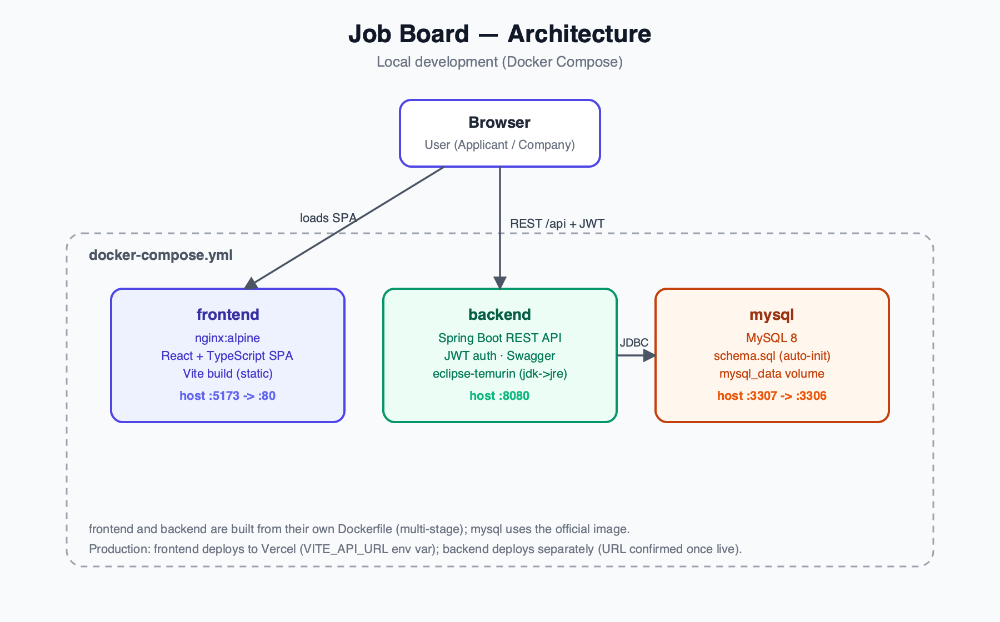
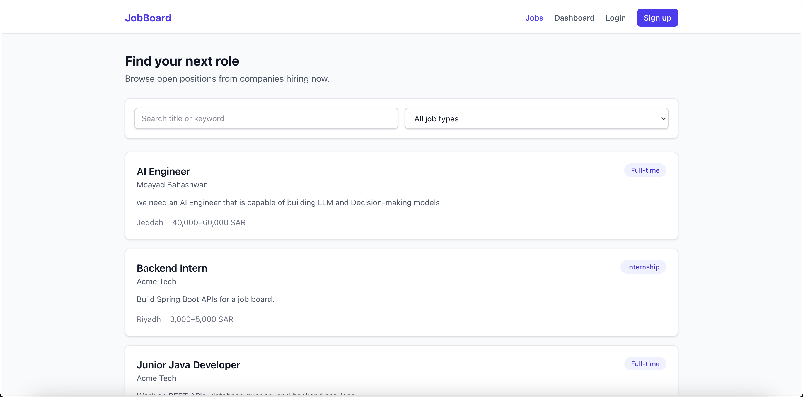
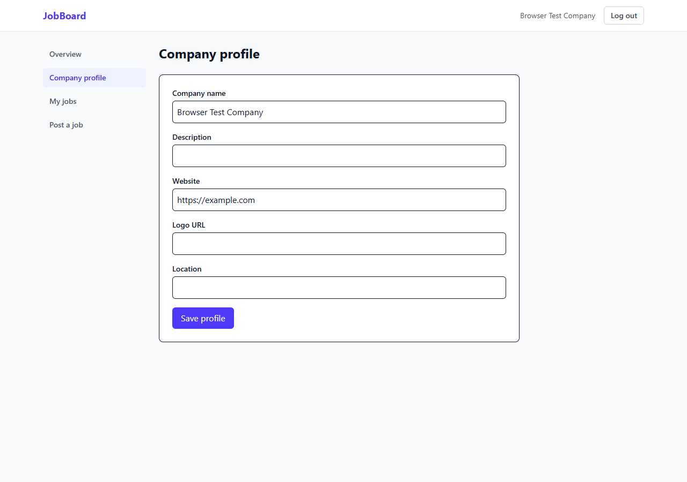
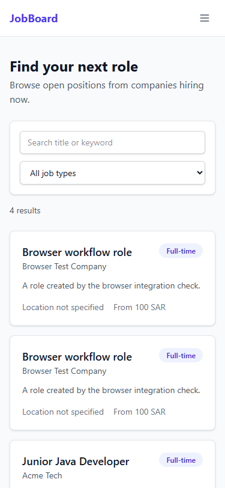
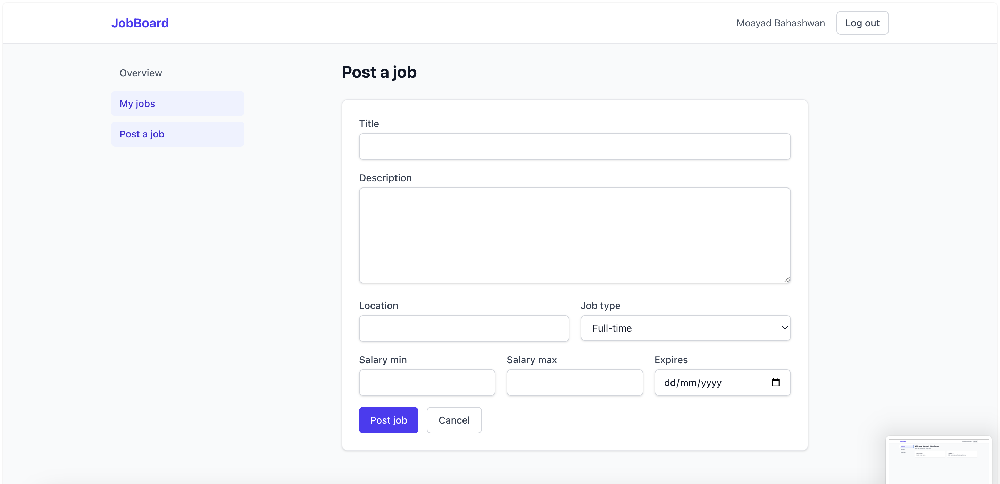
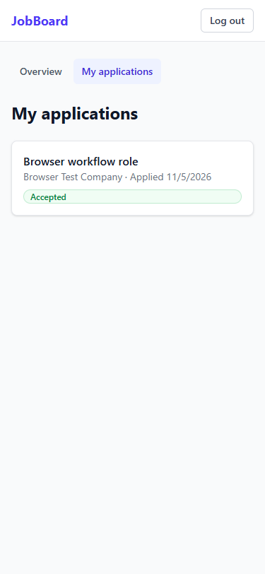
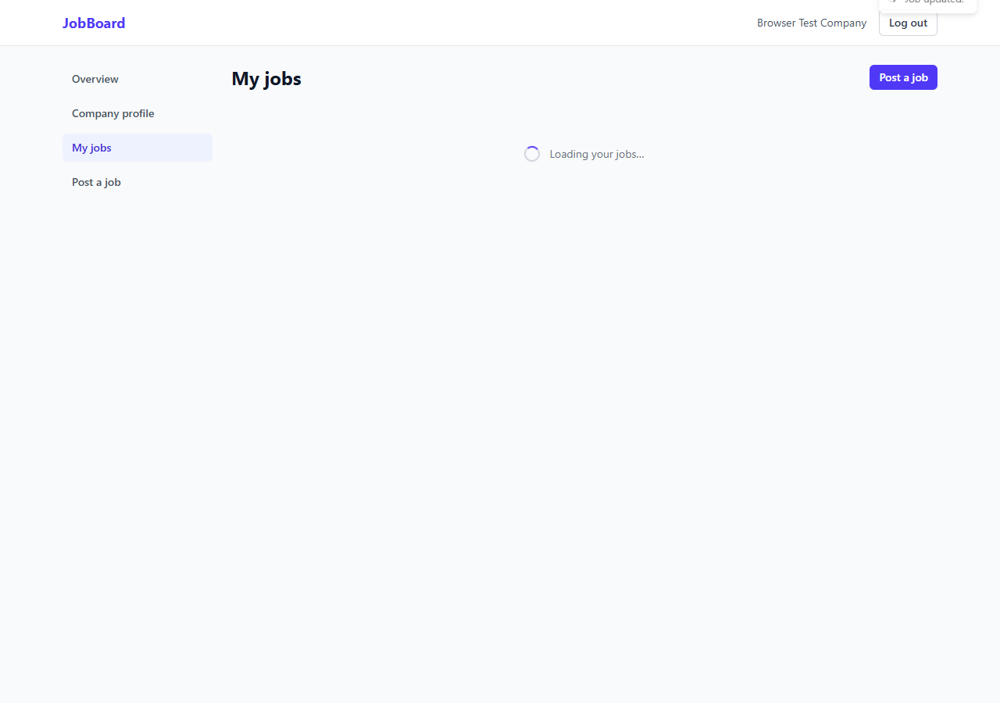

# Job Board

Applicants browse and apply to jobs; companies manage profiles, listings and application status.

## Architecture



Java 17 / Spring Boot, PostgreSQL 16, React 19 / TypeScript, Vite and nginx. Flyway runs database migrations at startup; Hibernate validates the resulting schema.

## Quick start

Requirements: Docker Desktop with its Linux engine running. The example configuration runs locally after copying it. Replace the database password and JWT key with unique values before deployment; never commit .env files.

Windows PowerShell:

```powershell
Copy-Item .env.example .env
docker compose up --build --wait
```

macOS / Linux:

```sh
cp .env.example .env
docker compose up --build --wait
```

Open http://localhost:5173. API: http://localhost:8080. Swagger: http://localhost:8080/swagger-ui.html. Health: http://localhost:8080/actuator/health.

Demo accounts (only created when APP_DEMO_ENABLED=true; disable this in production):

| Role | Email | Password |
| --- | --- | --- |
| Company | company@example.com | DemoPass123! |
| Applicant | applicant@example.com | DemoPass123! |

For a database-free development session, install JDK 17+ and Node 24. Set JAVA_HOME to your JDK and run:

```powershell
cd backend
.\run-local.ps1
# In another terminal, from the repository root:
cd frontend
npm ci
npm run dev
```

On macOS/Linux use backend/run-local.sh. This development profile uses in-memory H2 with the same Flyway migration and resets when stopped. It creates the demo accounts.

## Configuration

| Variable | Purpose / default |
| --- | --- |
| POSTGRES_DB / POSTGRES_USER / POSTGRES_PASSWORD | Compose database settings; example values in .env.example |
| POSTGRES_PORT | Host database port, 5433 |
| SPRING_DATASOURCE_URL / USERNAME / PASSWORD | Backend connection when running outside Compose |
| JWT_SECRET | Required UTF-8 HS256 key, at least 32 bytes; no production default |
| JWT_EXPIRATION | Token lifetime in milliseconds, 86400000 |
| APP_CORS_ALLOWED_ORIGINS | Comma-separated frontend origins, http://localhost:5173 |
| APP_DEMO_ENABLED | Creates demo data only when true; false by default |
| BACKEND_PORT | Host API port, 8080 |
| VITE_API_URL | API server origin; trailing slash accepted; set at frontend build time |
| JAVA_OPTS | JVM options for the backend container |

## API overview

| Endpoint | Access |
| --- | --- |
| POST /api/auth/register, /api/auth/login | Public; registration permits APPLICANT or COMPANY |
| GET /api/auth/me | Bearer token |
| GET /api/jobs | Public search, jobType, companyId, page >= 0, size 1–50; active, unexpired listings |
| GET /api/jobs/{id} | Public details including expiry and company |
| POST /api/jobs | Company |
| PUT /api/jobs/{id}, DELETE /api/jobs/{id}, PATCH /api/jobs/{id}/activate | Owning company |
| GET /api/jobs/my | Company's active and inactive listings |
| GET /api/companies/{id} | Public company profile |
| GET, PUT /api/companies/me | Company profile management |
| POST /api/jobs/{id}/apply, GET /api/jobs/{id}/my-application | Applicant |
| GET /api/applications/mine | Applicant status tracking |
| GET /api/jobs/{id}/applications, PUT /api/applications/{id}/status | Owning company |

Use Swagger's Authorize button with the token returned by login. The Postman collection is in postman/. Errors use {status, message, errors}; validation errors contain field messages. Unauthorized requests return 401, role/ownership failures 403, duplicate data 409.

## Verification

```sh
cd backend
./mvnw verify
cd ../frontend
npm ci
npm run build
npm run lint
npm test
```

Windows: replace ./mvnw with .\mvnw.cmd. Backend tests run Flyway on H2 in PostgreSQL mode, independently of Docker. CI runs Maven, frontend lint/tests/build, a full-history gitleaks scan, and a clean Docker/PostgreSQL stack with a Chromium workflow test. To run the browser check against a running stack: cd frontend, npx playwright install chromium, then npm run test:e2e. Also verify the real PostgreSQL/Compose stack and browser workflow before release: register both roles, post a job, apply, change the application status, then confirm the applicant sees it. A successful build alone does not validate that workflow.

## Database upgrades

New databases are initialized by V1__init.sql. Existing installations created by the old schema.sql must be backed up and checked against V1 before performing a deliberate Flyway baseline at version 1. Automatic baselining is disabled. Do not delete a production volume to resolve migration errors.

## Deployment

Frontend on Vercel: root directory frontend, build npm run build, output dist, VITE_API_URL set to the deployed API origin before building. SPA rewrites are in frontend/vercel.json.

Backend on Render/Railway: deploy backend/Dockerfile with managed PostgreSQL; configure the datasource variables, a unique JWT_SECRET and APP_CORS_ALLOWED_ORIGINS set to the exact frontend origin. Use HTTPS and APP_DEMO_ENABLED=false. Expose only the health actuator endpoint; configure the platform health check at /actuator/health. Database migrations run on startup.

## License

No project license was present in the source repository. An MIT grant has not been added because permission from all relevant rights holders has not been established. Historical authorship is preserved.

## Screenshots

**Home — browse & filter jobs**


**Company profile**


**Mobile search**


**Post a job**


**Applicant dashboard**


**Company dashboard**



## Branching

Work branches start from develop and merge back into develop. Releases merge develop into main without rewriting history.
